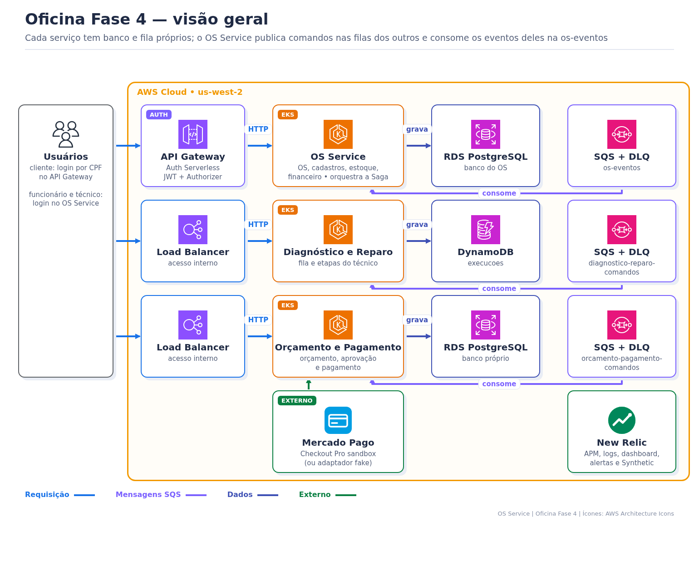
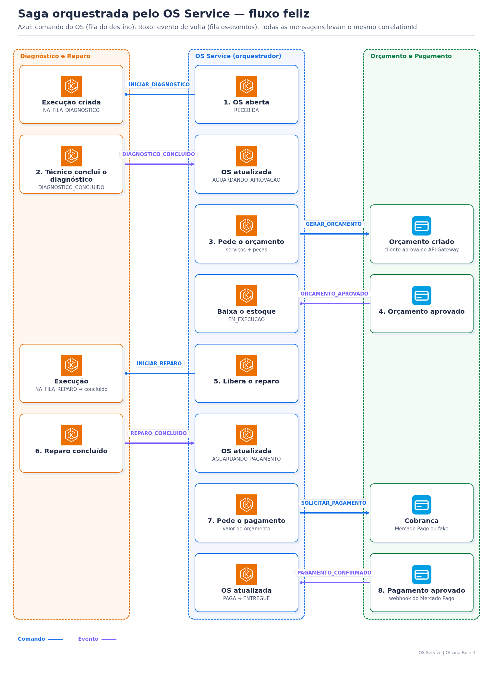

# Requisitos obrigatórios da Fase 4: onde cada um foi atendido

Este documento responde, item a item, o enunciado **SOAT — Fase 4 — Tech Challenge**. Cada resposta aponta o arquivo do repositório onde o requisito foi implementado e, quando existe, a execução do GitHub Actions que comprova o resultado. As pendências estão na [seção 9](#9-pendências).

Links de código apontam para a branch `homolog`, que já contém toda a documentação da Fase 4. As execuções de `main` são as de produção.

## 0. Repositórios da solução

| Repositório | Papel | Banco |
|---|---|---|
| [oficina-os-service](https://github.com/tiagomiele/oficina-os-service) | **OS Service**: abertura, status, histórico e consulta da OS; orquestrador da Saga; documentação central | RDS PostgreSQL |
| [oficina-orcamento-pagamento-service](https://github.com/tiagomiele/oficina-orcamento-pagamento-service) | **Orçamento e Pagamento** (Billing): orçamento, aprovação, pagamento Mercado Pago | RDS PostgreSQL |
| [oficina-diagnostico-reparo-service](https://github.com/tiagomiele/oficina-diagnostico-reparo-service) | **Diagnóstico e Reparo** (Execução e Produção): fila do técnico, diagnóstico, reparo | DynamoDB |
| [oficina-auth-serverless](https://github.com/tiagomiele/oficina-auth-serverless) | Login do cliente por CPF, JWT, Lambda Authorizer, API Gateway (Fase 3, ajustado) | nenhum (consulta o OS por REST) |
| [oficina-database-infra](https://github.com/tiagomiele/oficina-database-infra) | Terraform dos bancos e filas, uma pasta e um workspace por serviço | — |
| [oficina-kubernetes-infra](https://github.com/tiagomiele/oficina-kubernetes-infra) | Terraform da VPC, do EKS, dos add-ons e do New Relic | — |

Visão geral: 

---

## 1. Separação em microsserviços

> Refatore a aplicação em, no mínimo, 3 microsserviços independentes, cada um com seu próprio repositório, infraestrutura e banco de dados.

**Atendido.** O backend da Fase 3 foi dividido em 3 serviços Spring Boot. Cada um tem repositório, `Dockerfile`, manifestos `k8s/`, pipeline, namespace no EKS, LoadBalancer e banco próprios.

| Exigência do enunciado | Serviço | Onde está |
|---|---|---|
| Abertura da OS | OS Service | [`AdministrativoOficinaController`](https://github.com/tiagomiele/oficina-os-service/blob/homolog/src/main/java/br/com/oficina/adapter/controller/AdministrativoOficinaController.java) |
| Atualização de status | OS Service (pela Saga) | [`SagaOrdemServicoServiceImpl`](https://github.com/tiagomiele/oficina-os-service/blob/homolog/src/main/java/br/com/oficina/usecase/SagaOrdemServicoServiceImpl.java) |
| Consulta de status e histórico | OS Service | [`ClienteOficinaController`](https://github.com/tiagomiele/oficina-os-service/blob/homolog/src/main/java/br/com/oficina/adapter/controller/ClienteOficinaController.java), tabela `historico_status_ordem_servico` ([V3](https://github.com/tiagomiele/oficina-os-service/blob/homolog/src/main/resources/db/migration/V3__autenticacao_cpf_e_historico_status.sql)) |
| Geração e envio do orçamento para aprovação | Orçamento e Pagamento | [`OrcamentoController`](https://github.com/tiagomiele/oficina-orcamento-pagamento-service/blob/homolog/src/main/java/br/com/oficina/orcamentopagamento/adapter/controller/OrcamentoController.java), comando `GERAR_ORCAMENTO` em [`SqsComandosConsumidor`](https://github.com/tiagomiele/oficina-orcamento-pagamento-service/blob/homolog/src/main/java/br/com/oficina/orcamentopagamento/adapter/messaging/SqsComandosConsumidor.java) |
| Registro e verificação de pagamentos | Orçamento e Pagamento | [`PagamentoController`](https://github.com/tiagomiele/oficina-orcamento-pagamento-service/blob/homolog/src/main/java/br/com/oficina/orcamentopagamento/adapter/controller/PagamentoController.java), [`MercadoPagoWebhookController`](https://github.com/tiagomiele/oficina-orcamento-pagamento-service/blob/homolog/src/main/java/br/com/oficina/orcamentopagamento/adapter/controller/MercadoPagoWebhookController.java) |
| Atualização do status da OS após pagamento | Orçamento e Pagamento → OS | evento `PAGAMENTO_CONFIRMADO` → OS `PAGA` ([contrato](docs/saga/contrato-mensagens.md)) |
| Integração com o Mercado Pago | Orçamento e Pagamento | [`MercadoPagoPagamentoGateway`](https://github.com/tiagomiele/oficina-orcamento-pagamento-service/blob/homolog/src/main/java/br/com/oficina/orcamentopagamento/adapter/payment/MercadoPagoPagamentoGateway.java) (Checkout Pro sandbox), assinatura em [`MercadoPagoAssinatura`](https://github.com/tiagomiele/oficina-orcamento-pagamento-service/blob/homolog/src/main/java/br/com/oficina/orcamentopagamento/adapter/payment/MercadoPagoAssinatura.java). Explicação e diagrama: [README, seção 6](https://github.com/tiagomiele/oficina-orcamento-pagamento-service/blob/homolog/README.md#6-integração-com-o-mercado-pago) |
| Gerenciar a fila de execução da OS | Diagnóstico e Reparo | [`ExecucaoController`](https://github.com/tiagomiele/oficina-diagnostico-reparo-service/blob/homolog/src/main/java/br/com/oficina/diagnosticoreparo/adapter/controller/ExecucaoController.java) (`GET /execucoes/fila`), índice `etapa-entradaFilaEm-index` |
| Atualizar status durante diagnóstico e reparo | Diagnóstico e Reparo | [`ExecucaoService`](https://github.com/tiagomiele/oficina-diagnostico-reparo-service/blob/homolog/src/main/java/br/com/oficina/diagnosticoreparo/usecase/ExecucaoService.java) |
| Comunicar a finalização ao OS Service | Diagnóstico e Reparo → OS | eventos `DIAGNOSTICO_CONCLUIDO` e `REPARO_CONCLUIDO` na fila `os-eventos` |

**Pagamento validado em produção com o Mercado Pago Sandbox:** OS `OS-102026-000003`, pagamento `APROVADO`, provedor `mercadopago`, comprovante `185889123735`, OS em `PAGA`. Roteiro reproduzível: [`scripts/pagamento-mercadopago.ps1`](scripts/pagamento-mercadopago.ps1).

### Banco próprio, SQL e NoSQL

| Serviço | Banco | Tipo | Onde está |
|---|---|---|---|
| OS Service | RDS PostgreSQL 16 `oficina-<env>` | **SQL** | [`database-infra/os/main.tf`](https://github.com/tiagomiele/oficina-database-infra/blob/homolog/os/main.tf), migrations [`db/migration`](https://github.com/tiagomiele/oficina-os-service/tree/homolog/src/main/resources/db/migration) |
| Orçamento e Pagamento | RDS PostgreSQL 16 isolado | **SQL** | [`database-infra/orcamento-pagamento/`](https://github.com/tiagomiele/oficina-database-infra/tree/homolog/orcamento-pagamento), [`V1__orcamento_pagamento.sql`](https://github.com/tiagomiele/oficina-orcamento-pagamento-service/blob/homolog/src/main/resources/db/migration/V1__orcamento_pagamento.sql) |
| Diagnóstico e Reparo | DynamoDB `oficina-<env>-execucoes` | **NoSQL** | [`database-infra/diagnostico-reparo/`](https://github.com/tiagomiele/oficina-database-infra/tree/homolog/diagnostico-reparo), [`DynamoDbExecucaoRepository`](https://github.com/tiagomiele/oficina-diagnostico-reparo-service/blob/homolog/src/main/java/br/com/oficina/diagnosticoreparo/adapter/persistence/DynamoDbExecucaoRepository.java) |

Como ver os dados gravados (DBeaver/`psql` por túnel, Console e CLI do DynamoDB, SQS e DLQ): [database-infra, seção 6](https://github.com/tiagomiele/oficina-database-infra/blob/homolog/README.md#6-bancos-de-dados-e-como-ver-os-dados).

**Infraestrutura por serviço:** o Terraform dos bancos fica no `oficina-database-infra`, mas em **uma pasta por serviço**, cada uma com state, workspace HCP (`oficina-fase4-db-<serviço>-<env>`) e workflow próprios ([`os.yml`](https://github.com/tiagomiele/oficina-database-infra/blob/homolog/.github/workflows/os.yml), [`orcamento-pagamento.yml`](https://github.com/tiagomiele/oficina-database-infra/blob/homolog/.github/workflows/orcamento-pagamento.yml), [`diagnostico-reparo.yml`](https://github.com/tiagomiele/oficina-database-infra/blob/homolog/.github/workflows/diagnostico-reparo.yml)). Um deploy não depende do outro. Esse formato foi aceito pela coordenação. O cluster EKS é compartilhado, com um namespace por serviço, o que também foi aceito.

## 2. Comunicação entre microsserviços

| Estratégia | Uso | Onde está |
|---|---|---|
| REST síncrono | Usuários → serviços: funcionário e técnico chamam o LoadBalancer de cada serviço; o cliente chama pelo API Gateway com JWT | [`apigateway.tf`](https://github.com/tiagomiele/oficina-auth-serverless/blob/homolog/apigateway.tf), controllers de cada serviço |
| REST síncrono externo | Orçamento e Pagamento → Mercado Pago (criar cobrança, consultar pagamento); Mercado Pago → webhook | [`MercadoPagoPagamentoGateway`](https://github.com/tiagomiele/oficina-orcamento-pagamento-service/blob/homolog/src/main/java/br/com/oficina/orcamentopagamento/adapter/payment/MercadoPagoPagamentoGateway.java) |
| Mensageria assíncrona (**Amazon SQS** + DLQ) | Toda a comunicação **entre** os 3 serviços: comandos e eventos da Saga | [`SqsMensageriaGateway` (OS)](https://github.com/tiagomiele/oficina-os-service/blob/homolog/src/main/java/br/com/oficina/adapter/messaging/SqsMensageriaGateway.java), [`SqsEventosConsumidor`](https://github.com/tiagomiele/oficina-os-service/blob/homolog/src/main/java/br/com/oficina/adapter/messaging/SqsEventosConsumidor.java), módulo [`sqs-com-dlq`](https://github.com/tiagomiele/oficina-database-infra/tree/homolog/modules/sqs-com-dlq) |

| Fila | Consumidor | Publicadores |
|---|---|---|
| `oficina-<env>-os-eventos` | OS Service | Diagnóstico e Reparo, Orçamento e Pagamento |
| `oficina-<env>-diagnostico-reparo-comandos` | Diagnóstico e Reparo | OS Service |
| `oficina-<env>-orcamento-pagamento-comandos` | Orçamento e Pagamento | OS Service |

**Nenhum dos 3 serviços acessa o banco de outro.** Cada um recebe só as credenciais do próprio banco (variáveis do seu `k8s/app-deployment.yaml` e do seu GitHub Environment). Os dados que um serviço precisa do outro chegam no `payload` das mensagens. A Lambda de login do Auth também não acessa o banco do OS: ela chama a rota interna `POST /interno/clientes/autenticacao` do OS Service com a chave `X-Api-Key` ([`InternoClienteController`](src/main/java/br/com/oficina/adapter/controller/InternoClienteController.java), [`OsServiceClientRepository`](https://github.com/tiagomiele/oficina-auth-serverless/blob/homolog/src/main/java/br/com/oficina/auth/adapter/out/http/OsServiceClientRepository.java)).

## 3. Saga Pattern

**Estratégia: Saga orquestrada**, com o OS Service como orquestrador central.

**Justificativa da escolha:**
- O fluxo da OS é **sequencial e tem um dono natural**: diagnóstico → orçamento → aprovação → reparo → pagamento. O OS Service já guardava o status da OS na Fase 3, e esse status virou o estado da Saga, sem tabela extra.
- Toda a regra de "qual é o próximo passo" e "o que desfazer" fica num lugar só ([`SagaOrdemServicoServiceImpl`](https://github.com/tiagomiele/oficina-os-service/blob/homolog/src/main/java/br/com/oficina/usecase/SagaOrdemServicoServiceImpl.java)). Os outros serviços só obedecem comandos e respondem eventos.
- Na coreografia, cada serviço teria que conhecer os eventos dos outros, e as compensações ficariam espalhadas. Isso é mais difícil de explicar, testar e rastrear num projeto acadêmico.
- O rastreamento fica simples: o `correlationId` nasce na abertura da OS e o histórico da OS mostra a Saga inteira.

**Fluxo:** 

| Passo | Mensagem | De → Para | Status da OS |
|---|---|---|---|
| 1 | `INICIAR_DIAGNOSTICO` | OS → Diagnóstico | `RECEBIDA` |
| 2 | `DIAGNOSTICO_INICIADO` / `DIAGNOSTICO_CONCLUIDO` | Diagnóstico → OS | `EM_DIAGNOSTICO` → `AGUARDANDO_APROVACAO` |
| 3 | `GERAR_ORCAMENTO` | OS → Orçamento | `AGUARDANDO_APROVACAO` |
| 4 | `ORCAMENTO_APROVADO` | Orçamento → OS (baixa estoque) | `EM_EXECUCAO` |
| 5 | `INICIAR_REPARO` | OS → Diagnóstico/Reparo | `EM_EXECUCAO` |
| 6 | `REPARO_CONCLUIDO` | Reparo → OS | `AGUARDANDO_PAGAMENTO` |
| 7 | `SOLICITAR_PAGAMENTO` | OS → Pagamento | `AGUARDANDO_PAGAMENTO` |
| 8 | `PAGAMENTO_CONFIRMADO` | Pagamento → OS | `PAGA` → `ENTREGUE` |

**Rollback e compensação:**

| Falha | Compensação |
|---|---|
| Estoque insuficiente na aprovação | OS `CANCELADA`; OS envia `CANCELAR_ORCAMENTO` e `CANCELAR_EXECUCAO` |
| Cliente rejeita e cancela | OS `CANCELADA`; OS envia `CANCELAR_EXECUCAO` |
| Cliente rejeita para refazer | OS volta para `EM_DIAGNOSTICO`; novo `INICIAR_DIAGNOSTICO` |
| Pagamento recusado | OS fica em `AGUARDANDO_PAGAMENTO`; cliente tenta de novo (`nova-tentativa`) |
| Erro técnico ao processar | transação desfeita; a mensagem volta à fila; depois de 5 tentativas vai para a DLQ |
| Mensagem repetida ou fora de ordem | ignorada (idempotência por `messageId` em `mensagens_processadas` e checagem do status atual) |

Documentação completa e **como validar** (API, logs, filas, DLQ, banco, New Relic): [docs/saga/README.md](docs/saga/README.md). Contrato das mensagens: [docs/saga/contrato-mensagens.md](docs/saga/contrato-mensagens.md). A justificativa também está no [README central](README.md#7-saga-em-uma-página).

## 4. Testes e qualidade

| Exigência | Atendimento | Evidência |
|---|---|---|
| Testes unitários em todos os microsserviços | JUnit 5 + Mockito: OS (40 classes de teste), Orçamento e Pagamento (13), Diagnóstico e Reparo (10), Auth (18) | pastas `src/test` de cada repositório |
| Pelo menos um fluxo completo com BDD | Cucumber em português com os **3 serviços reais**, 2 PostgreSQL e LocalStack (SQS/DynamoDB): fluxo feliz e 4 compensações | [`bdd/.../saga.feature`](bdd/src/test/resources/features/saga.feature), workflow [`bdd.yml`](.github/workflows/bdd.yml), [run em main](https://github.com/tiagomiele/oficina-os-service/actions/runs/40979101686), [run em homolog](https://github.com/tiagomiele/oficina-os-service/actions/runs/41484365469) |
| Cobertura mínima de 80% por serviço | JaCoCo com `minimum 0.80` no `pom.xml`; o build falha abaixo disso | ver tabela abaixo |
| Qualidade via SonarQube ou similar no CI | **SonarCloud** com `sonar.qualitygate.wait=true` no job `SonarCloud` do `ci.yml`; o check é obrigatório no ruleset | [ci.yml do OS](.github/workflows/ci.yml) |

**Cobertura medida (relatório JaCoCo do último CI verde em `homolog`, 02/11/2026):**

| Serviço | Linhas | Instruções | Branches | Execução (artefato `jacoco-report`) |
|---|---|---|---|---|
| OS Service | 84,4% | 83,3% | 71,3% | [run 41484365373](https://github.com/tiagomiele/oficina-os-service/actions/runs/41484365373) |
| Orçamento e Pagamento | 99,0% | 99,4% | 93,9% | [run 41473064053](https://github.com/tiagomiele/oficina-orcamento-pagamento-service/actions/runs/41473064053) |
| Diagnóstico e Reparo | 99,4% | 99,2% | 92,5% | [run 41476675173](https://github.com/tiagomiele/oficina-diagnostico-reparo-service/actions/runs/41476675173) |

SonarCloud (Quality Gate **PASSED** nesses runs): [OS](https://sonarcloud.io/summary/overall?id=tiagomiele_oficina-os-service&branch=homolog) · [Orçamento e Pagamento](https://sonarcloud.io/summary/overall?id=tiagomiele_oficina-orcamento-pagamento-service&branch=homolog) · [Diagnóstico e Reparo](https://sonarcloud.io/summary/overall?id=tiagomiele_oficina-diagnostico-reparo-service&branch=homolog).

**Teste ponta a ponta no ambiente real:** o workflow [`e2e.yml`](.github/workflows/e2e.yml) roda a collection [`oficina-weeks4-5.postman_collection.json`](tests/postman/oficina-weeks4-5.postman_collection.json) com Newman contra os 3 serviços e o API Gateway. [Execução em produção](https://github.com/tiagomiele/oficina-os-service/actions/runs/41127248979) · [log Newman](https://github.com/tiagomiele/oficina-os-service/actions/runs/41127248979/job/124308855837).

## 5. CI/CD automatizado

Cada microsserviço tem pipeline independente, no próprio repositório:

| Etapa | OS | Orçamento e Pagamento | Diagnóstico e Reparo |
|---|---|---|---|
| Build + testes + JaCoCo | [`ci.yml`](.github/workflows/ci.yml) `Build, test & coverage` | [`ci.yml`](https://github.com/tiagomiele/oficina-orcamento-pagamento-service/blob/homolog/.github/workflows/ci.yml) | [`ci.yml`](https://github.com/tiagomiele/oficina-diagnostico-reparo-service/blob/homolog/.github/workflows/ci.yml) |
| Qualidade e segurança | SonarCloud, Security scan, SBOM CycloneDX + Dependency-Track | idem | idem |
| Deploy automatizado no Kubernetes | [`cd.yml`](.github/workflows/cd.yml) → [`deploy.yml`](.github/workflows/deploy.yml): push em `homolog` → namespace homolog; push em `main` → produção. Roda os testes, publica a imagem no GHCR e aplica `k8s/` com `kubectl` | [`cd.yml`](https://github.com/tiagomiele/oficina-orcamento-pagamento-service/blob/homolog/.github/workflows/cd.yml) | [`cd.yml`](https://github.com/tiagomiele/oficina-diagnostico-reparo-service/blob/homolog/.github/workflows/cd.yml) |
| Último deploy verde em produção | [CD 41064916135](https://github.com/tiagomiele/oficina-os-service/actions/runs/41064916135) | [CD 41134720703](https://github.com/tiagomiele/oficina-orcamento-pagamento-service/actions/runs/41134720703) | [CD 41057003582](https://github.com/tiagomiele/oficina-diagnostico-reparo-service/actions/runs/41057003582) |

**Repositórios protegidos:** os 6 repositórios têm os rulesets `Proteção main` e `Proteção homolog` ativos: PR obrigatório, sem push direto, sem force-push, conversas resolvidas e checks obrigatórios. Nos 3 serviços os checks obrigatórios são `Repository validation`, `Build, test & coverage`, `SonarCloud`, `SBOM (CycloneDX) + Dependency-Track` e `Security scan`. Os rulesets são criados e sincronizados por [`scripts/configure-environment.ps1`](scripts/configure-environment.ps1).

Infra também tem CI/CD: [kubernetes-infra](https://github.com/tiagomiele/oficina-kubernetes-infra/tree/homolog/.github/workflows), [database-infra](https://github.com/tiagomiele/oficina-database-infra/tree/homolog/.github/workflows) e [auth-serverless](https://github.com/tiagomiele/oficina-auth-serverless/tree/homolog/.github/workflows), com Terraform no HCP Terraform.

## 6. Infraestrutura

| Exigência | Atendimento |
|---|---|
| Cada microsserviço em seu repositório | Sim, ver [seção 0](#0-repositórios-da-solução) |
| Deploy automatizado para Kubernetes | Amazon EKS 1.34 ([`eks.tf`](https://github.com/tiagomiele/oficina-kubernetes-infra/blob/homolog/eks.tf)); cada serviço tem `Deployment`, `Service LoadBalancer`, `HPA` (só CPU), `PDB` e probes em `k8s/` ([OS](k8s/), [Orçamento](https://github.com/tiagomiele/oficina-orcamento-pagamento-service/tree/homolog/k8s), [Diagnóstico](https://github.com/tiagomiele/oficina-diagnostico-reparo-service/tree/homolog/k8s)) |
| Mensageria para orquestração | Amazon SQS + DLQ, ver [seção 2](#2-comunicação-entre-microsserviços) |
| Monitoramento e observabilidade da Fase 3 | New Relic, ver [seção 7](#7-monitoramento-e-rastreamento-dos-fluxos-distribuídos) |
| Ambientes | `homolog` e `production`, com subida do zero e destruição em [docs/bootstrap-aws-do-zero-fase4.md](docs/bootstrap-aws-do-zero-fase4.md) |

## 7. Monitoramento e rastreamento dos fluxos distribuídos

A observabilidade da Fase 3 (New Relic) foi mantida e estendida para os 3 serviços e a Saga:

- **APM Java** em cada serviço: agente no `Dockerfile` ([OS](Dockerfile)), transações e erros.
- **Logs JSON com `correlationId`** ([`logback-spring.xml`](src/main/resources/logback-spring.xml)) enviados pelo `newrelic-logging`. O `correlationId` nasce no `X-Request-Id` da abertura da OS e segue em todas as mensagens SQS ([`CorrelationIds`](src/main/java/br/com/oficina/adapter/messaging/CorrelationIds.java)). É o rastreamento distribuído aceito pelo professor.
- **Kubernetes** (`nri-bundle`), **Lambdas/API Gateway** e **RDS/SQS/DLQ** (`OficinaRdsSample`, `OficinaSqsSample`).
- **Dashboard `Oficina-fase4-<env>`** com as páginas Negócio, Aplicação, Kubernetes, Serverless e API Gateway, RDS PostgreSQL e **Saga** ([`dashboard.tf`](https://github.com/tiagomiele/oficina-kubernetes-infra/blob/homolog/observability/newrelic/dashboard.tf)); alertas ([`alerts.tf`](https://github.com/tiagomiele/oficina-kubernetes-infra/blob/homolog/observability/newrelic/alerts.tf)) e Synthetic ([`synthetics.tf`](https://github.com/tiagomiele/oficina-kubernetes-infra/blob/homolog/observability/newrelic/synthetics.tf)).

Como rastrear uma OS pela Saga (NRQL por `correlationId`): [kubernetes-infra, seção 6.4](https://github.com/tiagomiele/oficina-kubernetes-infra/blob/homolog/README.md#64-rastrear-uma-os-pela-saga) e [docs/saga/README.md](docs/saga/README.md).

## 8. Entregáveis

### Repositórios Git (um por microsserviço)

| Entregável | OS | Orçamento e Pagamento | Diagnóstico e Reparo |
|---|---|---|---|
| Código-fonte | [src](src/) | [src](https://github.com/tiagomiele/oficina-orcamento-pagamento-service/tree/homolog/src) | [src](https://github.com/tiagomiele/oficina-diagnostico-reparo-service/tree/homolog/src) |
| Dockerfile | [Dockerfile](Dockerfile) | [Dockerfile](https://github.com/tiagomiele/oficina-orcamento-pagamento-service/blob/homolog/Dockerfile) | [Dockerfile](https://github.com/tiagomiele/oficina-diagnostico-reparo-service/blob/homolog/Dockerfile) |
| Manifestos Kubernetes | [k8s](k8s/) | [k8s](https://github.com/tiagomiele/oficina-orcamento-pagamento-service/tree/homolog/k8s) | [k8s](https://github.com/tiagomiele/oficina-diagnostico-reparo-service/tree/homolog/k8s) |
| Pipelines CI/CD | [workflows](.github/workflows/) | [workflows](https://github.com/tiagomiele/oficina-orcamento-pagamento-service/tree/homolog/.github/workflows) | [workflows](https://github.com/tiagomiele/oficina-diagnostico-reparo-service/tree/homolog/.github/workflows) |
| Evidência de cobertura | [seção 4](#4-testes-e-qualidade) | [seção 4](#4-testes-e-qualidade) | [seção 4](#4-testes-e-qualidade) |
| Arquitetura do serviço | [README](README.md) | [README](https://github.com/tiagomiele/oficina-orcamento-pagamento-service#readme) | [README](https://github.com/tiagomiele/oficina-diagnostico-reparo-service#readme) |
| Swagger / Postman | `/swagger-ui.html` + [collection Postman](tests/postman/oficina-weeks4-5.postman_collection.json) | `/swagger-ui.html` ([README, seção 7](https://github.com/tiagomiele/oficina-orcamento-pagamento-service/blob/homolog/README.md#7-api-swagger)) | `/swagger-ui.html` ([README, seção 6](https://github.com/tiagomiele/oficina-diagnostico-reparo-service/blob/homolog/README.md#6-api-swagger)) |

O Auth tem o contrato OpenAPI em [`docs/openapi/oficina-auth.yaml`](https://github.com/tiagomiele/oficina-auth-serverless/blob/homolog/docs/openapi/oficina-auth.yaml).

### Vídeo de demonstração (até 15 minutos)

Sugestão de roteiro, com o que mostrar e onde:

| Tópico exigido | O que mostrar |
|---|---|
| Fluxo completo de uma OS pelos microsserviços | Rodar o [Validacao E2E](.github/workflows/e2e.yml) em `production` ou o [`pagamento-mercadopago.ps1`](scripts/pagamento-mercadopago.ps1), mostrando os status no histórico da OS |
| Saga e tratamento de falhas | Cenários de compensação do [BDD](bdd/src/test/resources/features/saga.feature) no run do `BDD Saga`; rejeição/cancelamento via Swagger; uma mensagem na DLQ |
| Deploy automatizado com validação de testes | Merge em `homolog` de um serviço → `CD` roda testes e faz o deploy no EKS |
| Monitoramento e rastreamento | Dashboard `Oficina-fase4-production`, página Saga, e busca de logs por `correlationId` |

### Documentação do portal (PDF)

| Item | Onde obter |
|---|---|
| Nome e identificação dos participantes | a preencher pelo grupo |
| Links dos repositórios | [seção 0](#0-repositórios-da-solução) |
| Link do vídeo | a preencher depois da gravação |
| Diagrama geral da arquitetura | [docs/assets/arquitetura-fase4.png](docs/assets/arquitetura-fase4.png) |
| Estratégia do Saga Pattern | [seção 3](#3-saga-pattern) |
| Justificativa da divisão e das tecnologias | [seção 10](#10-justificativa-da-divisão-e-das-tecnologias) |

## 9. Pendências

| # | Pendência | Responsável |
|---|---|---|
| 1 | Gravar e publicar o vídeo de até 15 minutos (YouTube/Vimeo, público ou não listado) | grupo |
| 2 | Montar o PDF do portal com participantes, links, vídeo, diagrama, Saga e justificativa (conteúdo nas seções 0, 3 e 10) | grupo |
| 3 | Promover `homolog → main` nos 6 repositórios: a documentação da Fase 4 e a correção do Mercado Pago ([orcamento-pagamento#8](https://github.com/tiagomiele/oficina-orcamento-pagamento-service/pull/8), no [PR #9](https://github.com/tiagomiele/oficina-orcamento-pagamento-service/pull/9)) ainda não estão na `main` | usuário |
| 4 | Evidência de cobertura no README de cada serviço: **feita** em [orcamento-pagamento#11](https://github.com/tiagomiele/oficina-orcamento-pagamento-service/pull/11) e [diagnostico-reparo#8](https://github.com/tiagomiele/oficina-diagnostico-reparo-service/pull/8); falta o merge | usuário (merge) |
| 5 | Auth sem acesso ao banco do OS: **feito** em [os-service#24](https://github.com/tiagomiele/oficina-os-service/pull/24), [auth-serverless#9](https://github.com/tiagomiele/oficina-auth-serverless/pull/9) e [database-infra#8](https://github.com/tiagomiele/oficina-database-infra/pull/8). Falta o merge e o deploy, nesta ordem: OS Service (CD) → Auth (Terraform deploy) | usuário (merge e deploy) |
| 6 | Os projetos do SonarCloud podem estar privados: os links da seção 4 só abrem para quem tem acesso. Para o professor ver, deixe-os públicos ou use prints | usuário |

## 10. Justificativa da divisão e das tecnologias

**Divisão dos microsserviços:** segue as 3 áreas do enunciado e os limites de negócio da oficina.
- **OS Service** ficou com o que era o centro do backend da Fase 3 (cadastros, OS, estoque, financeiro) e passou a orquestrar a Saga. Isso manteve a mudança mínima em relação à Fase 3.
- **Orçamento e Pagamento** isola a parte financeira e a integração externa com o Mercado Pago, que muda por motivos diferentes do restante.
- **Diagnóstico e Reparo** isola o trabalho do técnico, que tem volume alto de leituras da fila e atualizações de etapa.

**Tecnologias:**

| Tecnologia | Por quê |
|---|---|
| Java 21 + Spring Boot 3.3 | mesma base da Fase 3; equipe já domina |
| PostgreSQL (RDS) | OS e Orçamento/Pagamento têm dados relacionais e transações (estoque, valores) |
| DynamoDB | Diagnóstico e Reparo guarda um documento por execução e lê por etapa/ordem de chegada; atende o NoSQL obrigatório sem servidor para manter |
| Amazon SQS + DLQ | gerenciado, barato, disponível no AWS Academy; DLQ e redrive prontos |
| Saga orquestrada | ver [seção 3](#3-saga-pattern) |
| Amazon EKS + HPA | mesmo cluster da Fase 3, um namespace por serviço |
| Terraform + HCP Terraform | infraestrutura como código, já usada na Fase 3 |
| GitHub Actions + SonarCloud + JaCoCo + Cucumber | CI/CD, qualidade e BDD no mesmo lugar do código |
| Mercado Pago Checkout Pro (sandbox) + adaptador fake | integração real exigida e testes automáticos sem depender do provedor |
| New Relic | observabilidade já implementada na Fase 3 |
