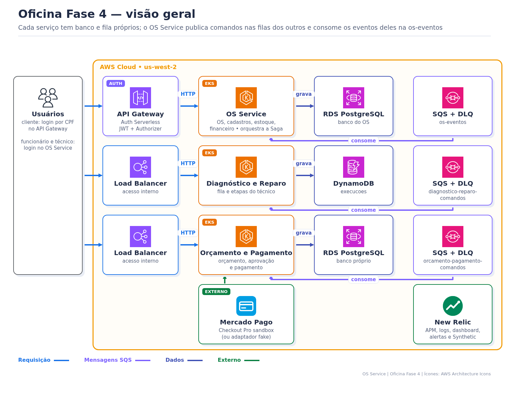
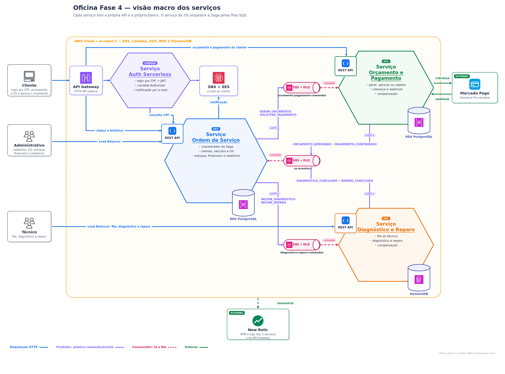
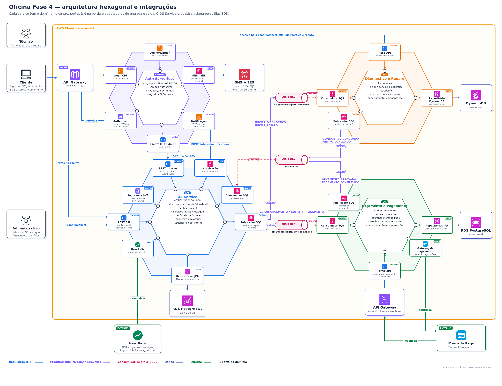
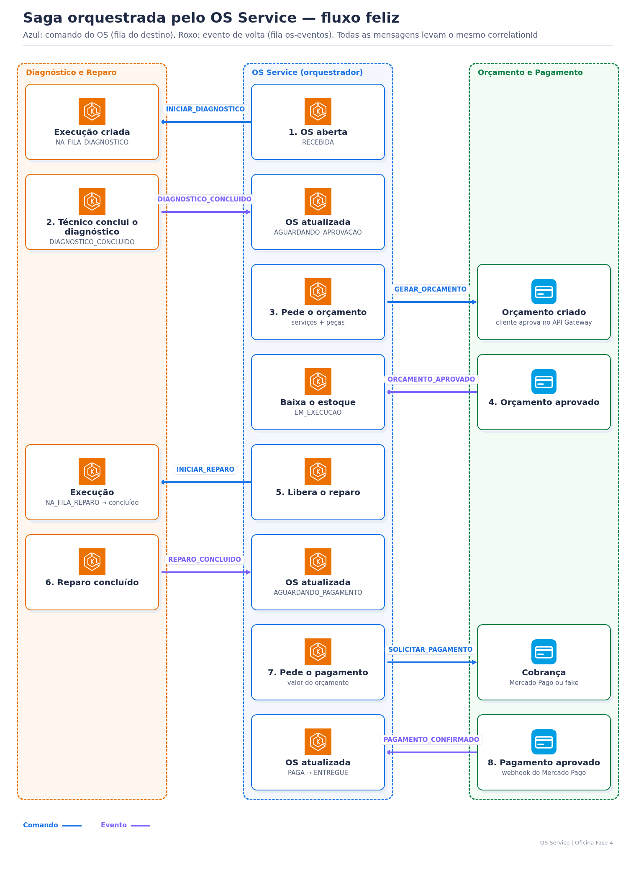
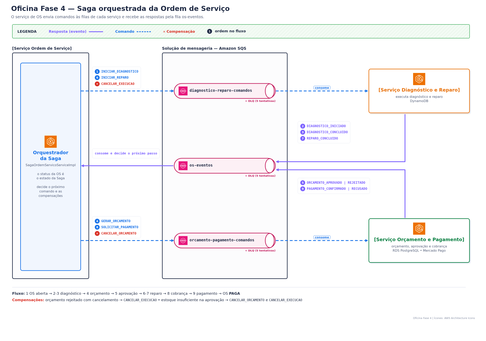

> **Tech Challenge Fase 4 — `oficina-os-service`** · documentação central da solução

# Oficina Fase 4 — documentação central

Este repositório é o ponto de entrada da Oficina Fase 4: o que a solução faz, como os 6 repositórios se encaixam, como a Saga funciona e como subir e destruir tudo na AWS. O detalhe de cada parte fica no repositório específico (links na seção 3).

**Atendimento ao enunciado da Fase 4, item a item:** [README-requisitos-obrigatorios-fase4.md](README-requisitos-obrigatorios-fase4.md).

**Índice das documentações e evidências da Fase 4:** [README-Indice-Evidencia-fase4.md](README-Indice-Evidencia-fase4.md).

## 1. O que a solução faz

Uma oficina mecânica controla o atendimento de ponta a ponta: cadastro de cliente e veículo, abertura da Ordem de Serviço (OS), diagnóstico, orçamento, aprovação pelo cliente, reparo com baixa de peças, pagamento (Mercado Pago) e entrega.

```text
RECEBIDA → EM_DIAGNOSTICO → AGUARDANDO_APROVACAO → EM_EXECUCAO → AGUARDANDO_PAGAMENTO → PAGA → ENTREGUE
                                     └─ rejeitado: refaz o diagnóstico ou CANCELADA
```

Na Fase 4 o antigo backend foi dividido em 3 serviços. Cada um tem banco próprio e conversa com os outros só por mensagens SQS, numa **Saga orquestrada** pelo OS Service.

## 2. Arquitetura



**Visão macro dos serviços e conexões principais**



**Arquitetura hexagonal: portas, adaptadores e integrações de cada serviço**



## 3. Repositórios

| Repositório | Responsabilidade | Dados | Documentação |
|---|---|---|---|
| **oficina-os-service** (este) | clientes, veículos, OS, catálogo, estoque, notas de fornecedor, financeiro, usuários, relatórios; orquestra a Saga | RDS PostgreSQL | este README, [Saga](docs/saga/README.md), [Bootstrap](docs/bootstrap-aws-do-zero-fase4.md) |
| [oficina-diagnostico-reparo-service](https://github.com/tiagomiele/oficina-diagnostico-reparo-service) | fila e etapas do técnico (diagnóstico e reparo) | DynamoDB | [README](https://github.com/tiagomiele/oficina-diagnostico-reparo-service#readme) |
| [oficina-orcamento-pagamento-service](https://github.com/tiagomiele/oficina-orcamento-pagamento-service) | orçamento, aprovação do cliente, pagamento Mercado Pago/fake e webhook | RDS PostgreSQL | [README](https://github.com/tiagomiele/oficina-orcamento-pagamento-service#readme) |
| [oficina-auth-serverless](https://github.com/tiagomiele/oficina-auth-serverless) | login do cliente por CPF, JWT RS256, Authorizer, API Gateway e notificações | consulta o OS por REST (`POST /interno/clientes/autenticacao`) | [README](https://github.com/tiagomiele/oficina-auth-serverless#readme) |
| [oficina-database-infra](https://github.com/tiagomiele/oficina-database-infra) | 2 RDS, DynamoDB, 3 filas SQS com DLQ e telemetria | — | [README](https://github.com/tiagomiele/oficina-database-infra#readme) |
| [oficina-kubernetes-infra](https://github.com/tiagomiele/oficina-kubernetes-infra) | VPC, EKS, add-ons e observabilidade New Relic | — | [README](https://github.com/tiagomiele/oficina-kubernetes-infra#readme) |

## 4. Requisitos funcionais

| Requisito | Serviço |
|---|---|
| Cadastro de clientes, veículos, serviços, peças, usuários e notas fiscais de fornecedor | OS |
| Abertura e acompanhamento da OS, histórico de status e consulta pública do status | OS |
| Fila do técnico, diagnóstico com serviços e peças, reparo | Diagnóstico e Reparo |
| Orçamento gerado pela Saga; cliente aprova, rejeita para refazer ou cancela | Orçamento e Pagamento |
| Pagamento pelo Mercado Pago Checkout Pro (sandbox) ou fake; webhook com assinatura | Orçamento e Pagamento |
| Baixa de estoque na aprovação; compensação quando falta peça | OS |
| Contas a receber/pagar e relatórios (tempo médio, OS por status) | OS |
| Login do cliente por CPF e notificações | Auth |

## 5. Requisitos técnicos

| Tema | Como foi atendido |
|---|---|
| Microsserviços | 3 serviços Spring Boot, deploy e pipeline independentes, namespace próprio no EKS |
| Banco por serviço | PostgreSQL (OS e Orçamento/Pagamento) e DynamoDB (Diagnóstico/Reparo) |
| Saga orquestrada | comandos e eventos em SQS, DLQ após 5 falhas, idempotência por `messageId`, compensações |
| Segurança | JWT interno (funcionário) e JWT RS256 do Auth (cliente), API Gateway + Authorizer, RDS privado com SSL |
| Qualidade | testes ≥ 80% (JaCoCo), BDD Cucumber da Saga, E2E Newman, SonarCloud |
| Observabilidade | New Relic APM, logs com `correlationId`, dashboard, alertas e Synthetic |
| Ambientes | `homolog` e `production`, promoção `feature → homolog → main` |

## 6. Stack do OS Service

Java 21, Spring Boot 3.3.4 (Web, Security, Data JPA, Validation, Actuator), Flyway, PostgreSQL 16, AWS SDK (SQS), springdoc-openapi 2.6.0, JUnit 5, Cucumber (em `bdd/`), JaCoCo, Spotless, Docker, Kubernetes e New Relic Java agent. Arquitetura limpa em 4 anéis: `domain`, `usecase`, `adapter` e `infrastructure`.

## 7. Saga em uma página



**Comandos e eventos da Saga orquestrada**



**Por que orquestrada:** o fluxo da OS é sequencial e o OS Service já era o dono do status da OS, que virou o estado da Saga. A regra do próximo passo e das compensações fica num lugar só, e os outros serviços só recebem comandos e respondem eventos. Na coreografia, cada serviço teria que conhecer os eventos dos outros e as compensações ficariam espalhadas, o que é mais difícil de testar e rastrear.

Comandos, eventos, compensações e **como validar** (logs, filas, DLQ, banco, New Relic e BDD): [docs/saga/README.md](docs/saga/README.md). Contrato das mensagens: [docs/saga/contrato-mensagens.md](docs/saga/contrato-mensagens.md).

## 8. API (Swagger)

Swagger UI em `<url-do-serviço>/swagger-ui.html` e OpenAPI em `/v3/api-docs`, com schemas, exemplos e erros. Use **Authorize** com o token de `POST /auth/login`.

| Controller | Quem usa | Exemplos de rotas |
|---|---|---|
| Administrativo | funcionário | `/clientes`, `/veiculos`, `/servicos`, `/pecas`, `/ordens-servico`, `/estoque`, `/notas-fiscais-fornecedor`, `/contas-a-receber`, `/relatorios/*`, `/usuarios` |
| Técnico | técnico | `/ordens-servico/{numeroOs}/servicos`, `/pecas`, `/entregar`, `/cancelar-diagnostico` |
| Cliente | público | `/consulta/ordens-servico/{numeroOs}/status`, `/ordens-servico/{numeroOs}/historico` |
| Auth | todos | `POST /auth/login` |
| Interno | Lambda de login do Auth (chave `X-Api-Key`) | `POST /interno/clientes/autenticacao`: devolve o `idCliente` de um CPF ativo, ou 404 |

Ver os dados gravados (DBeaver/`psql` por túnel, DynamoDB e filas): [Database Infra](https://github.com/tiagomiele/oficina-database-infra#readme).

## 9. Executar

### Pré-requisitos

- Java 21;
- Docker e Docker Compose;
- Git;
- acesso à AWS, ao cluster EKS e aos ambientes GitHub somente para implantação remota.

O Maven Wrapper está incluído; não é necessário instalar Maven globalmente.

### Executar localmente com Docker

```bash
git clone https://github.com/tiagomiele/oficina-os-service.git
cd oficina-os-service
docker compose up --build
```

Serviços locais:

- API: `http://localhost:8080`;
- Swagger UI: `http://localhost:8080/swagger-ui.html`;
- OpenAPI JSON: `http://localhost:8080/v3/api-docs`;
- healthcheck: `http://localhost:8080/actuator/health`;
- Adminer: `http://localhost:8081`.

As credenciais presentes no `docker-compose.yml` destinam-se exclusivamente ao desenvolvimento local. Valores reais devem permanecer em Secrets, GitHub Environments ou HCP Terraform.

### Executar a aplicação com o Maven Wrapper

Inicie somente o PostgreSQL:

```bash
docker compose up -d db
```

Depois execute:

```bash
./mvnw spring-boot:run
```

No Windows PowerShell:

```powershell
.\mvnw.cmd spring-boot:run
```

As variáveis disponíveis estão documentadas em [.env.example](.env.example). Não versione arquivos `.env` com valores reais.

### Testes e validações

```bash
./mvnw -B clean verify spotless:check
```

A suíte inclui testes unitários, integração, persistência, segurança, contrato e arquitetura. O pipeline também executa SBOM, análise de vulnerabilidades e testes funcionais Postman/Newman.

- [Collection Postman integrada](tests/postman/oficina-weeks4-5.postman_collection.json)
- [Ambiente Postman de exemplo](tests/postman/oficina-homolog.postman_environment.example.json)
- [Teste de carga smoke](tests/k6/smoke-load.js)

### Configuração

Principais variáveis:

| Variável | Finalidade |
|---|---|
| `DB_URL`, `DB_USER`, `DB_PASSWORD` | conexão PostgreSQL |
| `JWT_SECRET` | autenticação interna da equipe |
| `SERVERLESS_JWT_PUBLIC_KEY` | validação dos tokens emitidos pelo Auth |
| `SERVERLESS_JWT_ISSUER`, `SERVERLESS_JWT_AUDIENCE` | validação do emissor e da audiência |
| `AUTH_BASE_URL` | URL do Auth Serverless |
| `NOTIFICATION_ENDPOINT`, `NOTIFICATION_API_KEY` | integração de notificações |
| `OFICINA_ENVIRONMENT` | identificação do ambiente |
| `OFICINA_OBSERVABILITY_NEW_RELIC_ENABLED` | habilitação da integração New Relic |

## 10. CI/CD

| Workflow | Quando | O que faz |
|---|---|---|
| `ci.yml` | push e PR em `homolog`/`main` | build, testes, cobertura, SBOM, segurança e SonarCloud |
| `bdd.yml` | push e PR em `homolog`/`main` | BDD da Saga com os 3 serviços e LocalStack |
| `cd.yml` → `deploy.yml` | push em `homolog`/`main` | imagem, ConfigMap/Secret e deploy no EKS (`DEPLOY_ENABLED`) |
| `e2e.yml` | push na `homolog` ou manual | aquece as Lambdas e roda a coleção Newman (pagamento fake) |

## 11. Subir e destruir na AWS

O passo a passo completo, para quem nunca viu o projeto, está no **[Bootstrap da Fase 4](docs/bootstrap-aws-do-zero-fase4.md)**: preparação, homologação, produção, validação da Saga, Mercado Pago e, na seção 26, a **destruição da infraestrutura para economizar créditos** (`scripts/destroy-environment.ps1`).

Para subir um ambiente inteiro com um único comando, use o **[Bootstrap de uma única vez](README-bootstrap-unica-vez.md)** (`scripts/provision-environment.ps1`).

| Script | Para quê |
|---|---|
| `scripts/configure-environment.ps1` | cria e sincroniza workspaces HCP, variáveis e secrets do GitHub |
| `scripts/provision-environment.ps1` | sobe um ambiente inteiro (homolog ou production) de uma vez |
| `scripts/destroy-environment.ps1` | destrói um ambiente na ordem certa |
| `scripts/pagamento-mercadopago.ps1` | teste manual do Mercado Pago sandbox em produção |

## 12. Histórico

Documentação das fases anteriores: [Fase 1](docs-fase1), [Fase 2](docs-fase2), [Fase 3](docs-fase3), [requisitos da Fase 3](docs-fase3/README-requisitos-obrigatorios-fase3.md) e [índice de evidências da Fase 3](docs-fase3/README-Indice-Evidencia-fase3.md).

## Licença

Consulte o arquivo [LICENSE](LICENSE).
