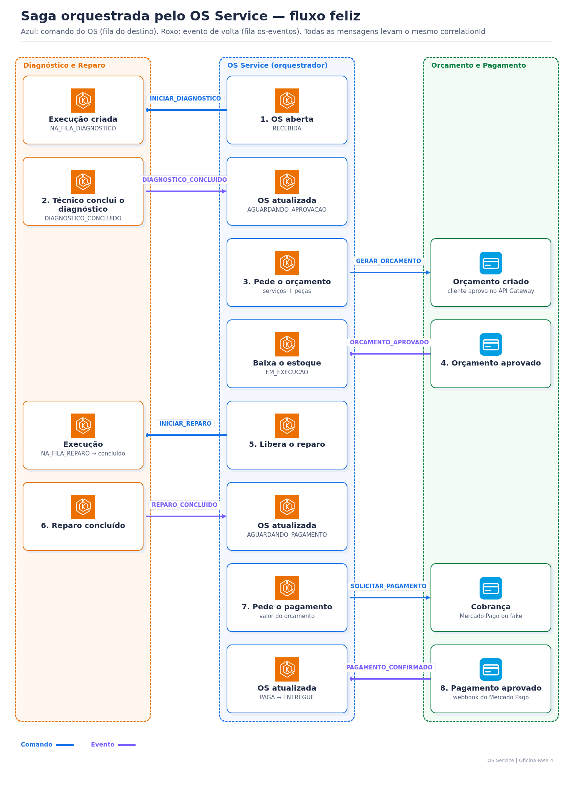

# Saga da OS — como funciona e como validar



## 1. Ideia

O **OS Service** é o orquestrador. Ele guarda o status da OS e decide o próximo passo. Os outros serviços só recebem **comandos** na fila deles e respondem com **eventos** na fila `os-eventos`.

| Fila (`oficina-<env>-…`) | Consumidor | DLQ |
|---|---|---|
| `os-eventos` | OS Service | `os-eventos-dlq` |
| `diagnostico-reparo-comandos` | Diagnóstico e Reparo | `…-dlq` |
| `orcamento-pagamento-comandos` | Orçamento e Pagamento | `…-dlq` |

Toda mensagem tem `messageId` (idempotência), `tipo`, `numeroOs` e o mesmo `correlationId` da OS. Contrato completo: [contrato-mensagens.md](contrato-mensagens.md).

## 2. Passo a passo (fluxo feliz)

| # | Mensagem | De → para | Status da OS depois |
|---|---|---|---|
| 1 | `INICIAR_DIAGNOSTICO` | OS → Diagnóstico | `RECEBIDA` |
| 2 | `DIAGNOSTICO_INICIADO` / `DIAGNOSTICO_CONCLUIDO` | Diagnóstico → OS | `EM_DIAGNOSTICO` / `AGUARDANDO_APROVACAO` |
| 3 | `GERAR_ORCAMENTO` | OS → Orçamento | `AGUARDANDO_APROVACAO` |
| 4 | `ORCAMENTO_APROVADO` | Orçamento → OS | baixa de estoque → `EM_EXECUCAO` |
| 5 | `INICIAR_REPARO` | OS → Diagnóstico | `EM_EXECUCAO` |
| 6 | `REPARO_CONCLUIDO` | Diagnóstico → OS | `AGUARDANDO_PAGAMENTO` |
| 7 | `SOLICITAR_PAGAMENTO` | OS → Orçamento | `AGUARDANDO_PAGAMENTO` |
| 8 | `PAGAMENTO_CONFIRMADO` | Orçamento → OS | `PAGA` (depois `ENTREGUE` pelo técnico) |

## 3. Compensações

| Situação | O que acontece |
|---|---|
| Falta peça na aprovação | OS `CANCELADA`; OS envia `CANCELAR_ORCAMENTO` e `CANCELAR_EXECUCAO`; nada é baixado |
| Cliente rejeita e cancela | OS `CANCELADA`; OS envia `CANCELAR_EXECUCAO` |
| Cliente rejeita e pede refazer | OS volta a `EM_DIAGNOSTICO`; OS envia `INICIAR_DIAGNOSTICO` com `refazer` |
| Pagamento recusado | OS continua `AGUARDANDO_PAGAMENTO`; o cliente pode pagar de novo no mesmo link |

Mensagem repetida é ignorada (`mensagens_processadas`). Erro no processamento desfaz a transação e a mensagem volta à fila; depois de 5 tentativas vai para a DLQ.

## 4. Como validar

**Pela API** — status e histórico da OS (público):

```powershell
Invoke-RestMethod "$OS/consulta/ordens-servico/OS-102026-000003/status"
Invoke-RestMethod "$OS/ordens-servico/OS-102026-000003/historico"
```

**Pelos logs** — cada evento aplicado aparece como `Saga OS <n>: aplicando evento <tipo>`; compensações como `Saga OS <n>: compensação por …`:

```powershell
kubectl logs -n oficina-production deploy/oficina-app --tail 300 | Select-String 'Saga OS'
kubectl logs -n oficina-diagnostico-reparo-production deploy/oficina-diagnostico-reparo --tail 200 | Select-String 'OS-102026-000003'
kubectl logs -n oficina-orcamento-pagamento-production deploy/oficina-orcamento-pagamento --tail 200 | Select-String 'OS-102026-000003'
```

**Pelas filas** — mensagens paradas e DLQs (todas devem ficar em 0):

```powershell
aws sqs list-queues --region us-west-2 --queue-name-prefix oficina-production --query 'QueueUrls' --output text |
  ForEach-Object { $_ -split '\s+' } | ForEach-Object {
    $a = aws sqs get-queue-attributes --region us-west-2 --queue-url $_ --attribute-names ApproximateNumberOfMessages | ConvertFrom-Json
    '{0,-60} {1}' -f ($_ -replace '^.*/', ''), $a.Attributes.ApproximateNumberOfMessages }
```

Ler e reprocessar uma DLQ: [Database Infra](https://github.com/tiagomiele/oficina-database-infra#readme).

**Pelo banco** — `SELECT tipo, numero_os, correlation_id, processada_em FROM mensagens_processadas ORDER BY processada_em DESC LIMIT 20;` (acesso por túnel no Database Infra).

**Pelo New Relic** — dashboard `Oficina-fase4-<env>`, página **Saga** (eventos aplicados, compensações, DLQs, falhas). Para seguir uma OS nos 3 serviços:

```sql
SELECT timestamp, namespace_name, message FROM Log WHERE correlationId = '<correlationId>' SINCE 1 day ago ORDER BY timestamp
```

**Automatizado** — BDD com os 3 serviços e LocalStack (fluxo feliz, falta de estoque, rejeições e pagamento recusado): `cd bdd; ./run-bdd.sh` ([bdd/README.md](../../bdd/README.md)). E2E nos ambientes AWS: workflow `e2e.yml`.
